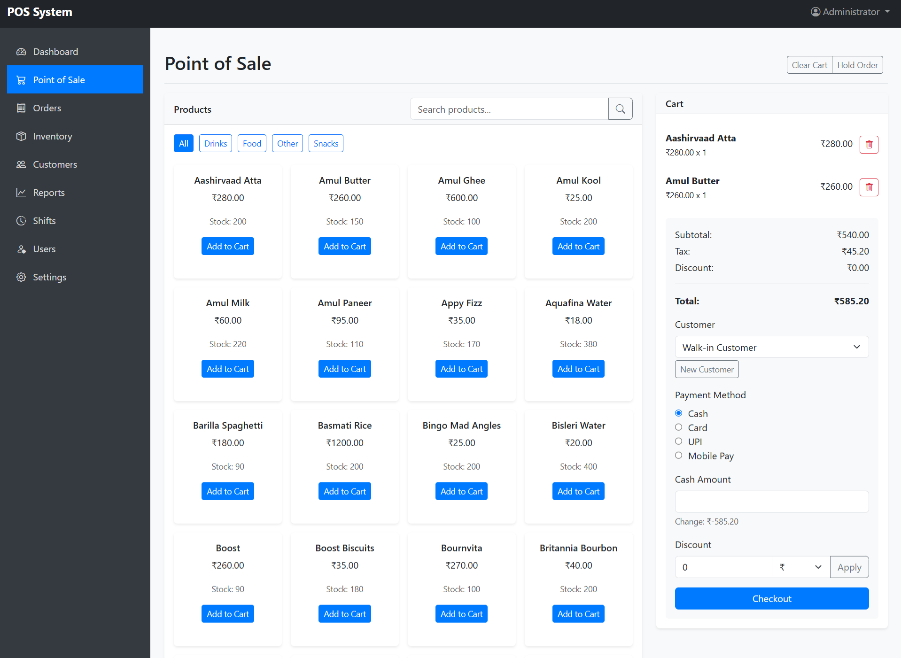
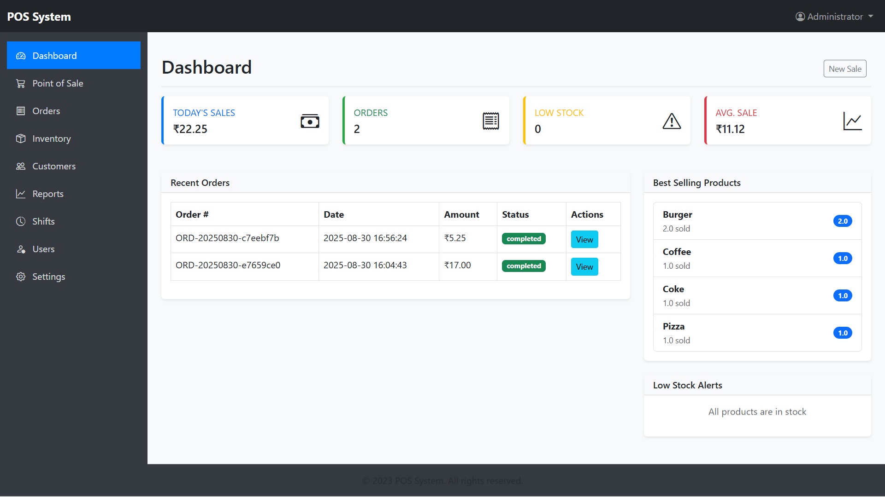
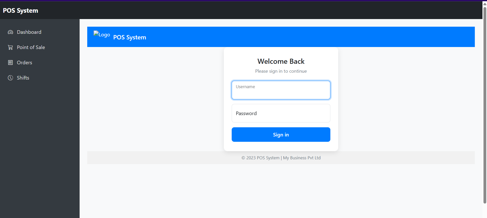
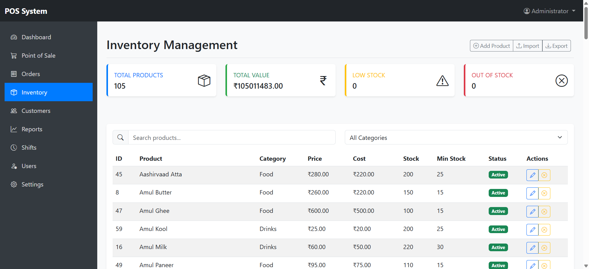
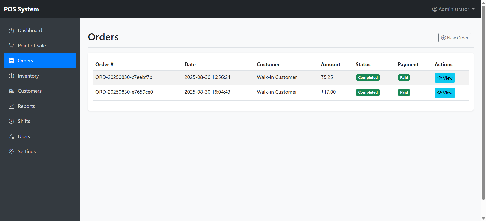
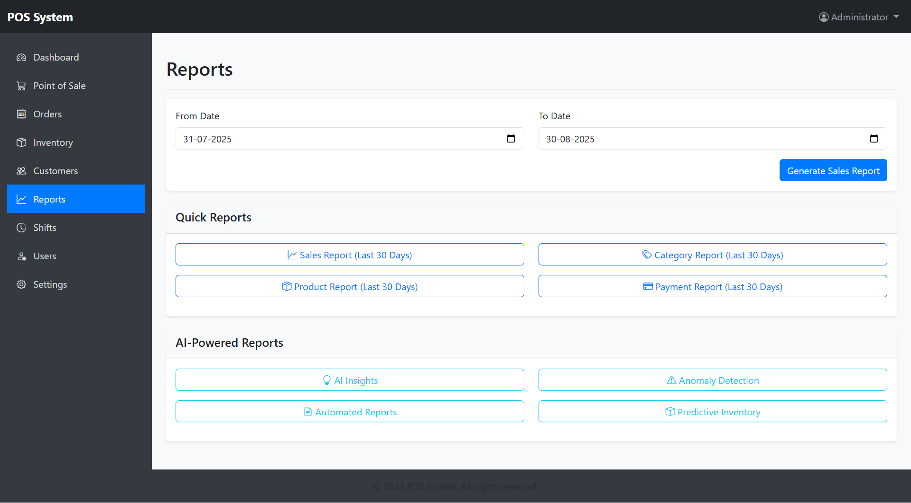
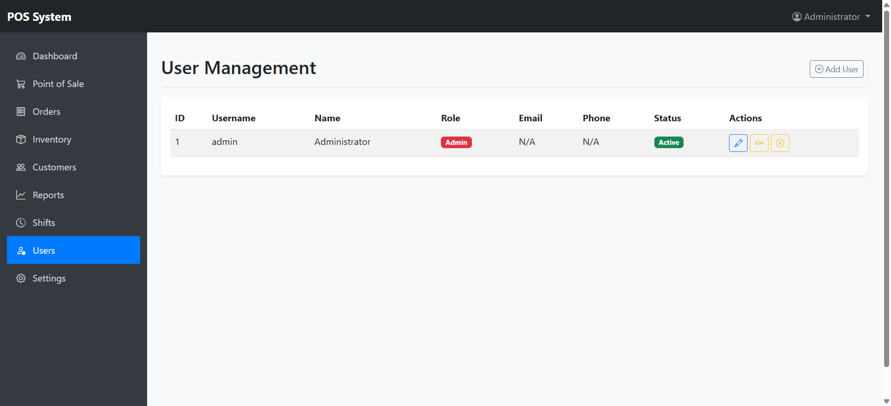
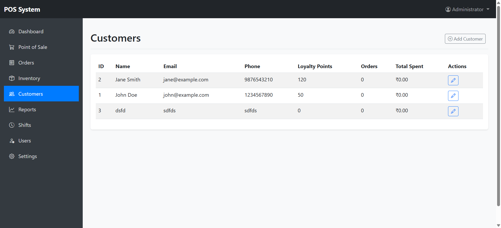
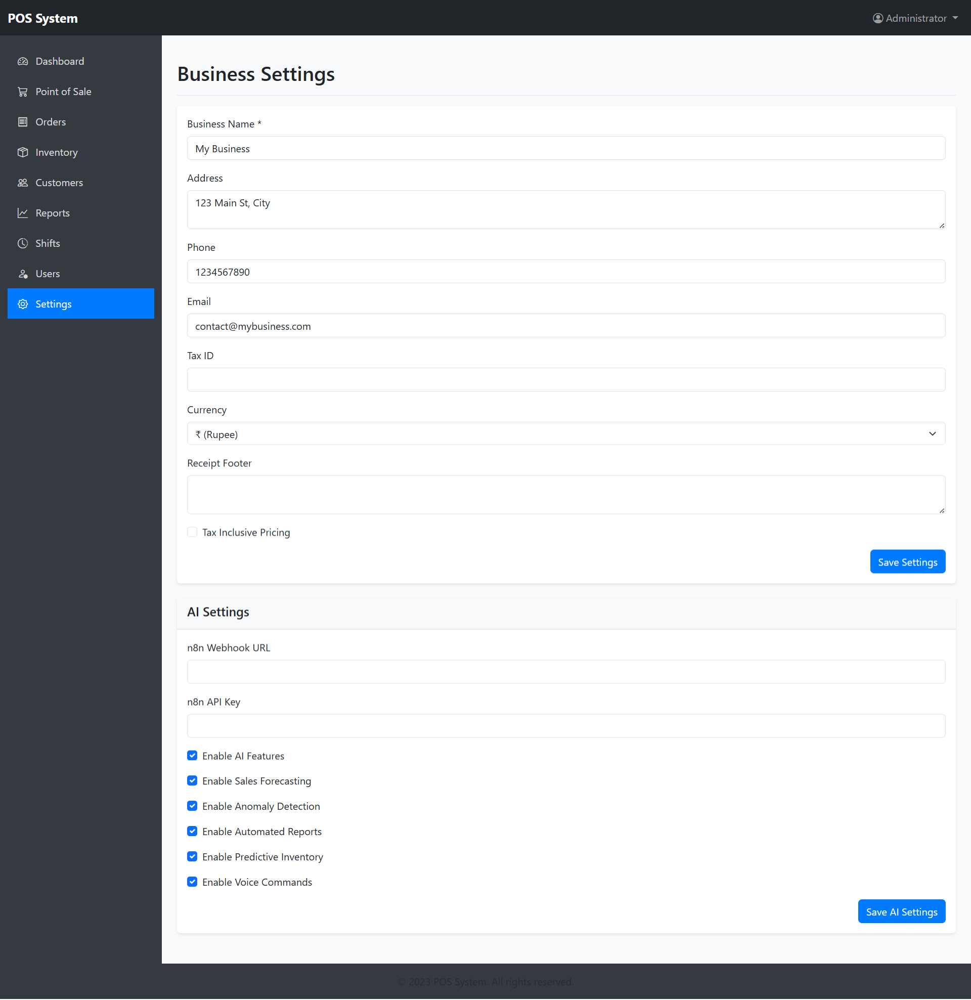

## How to Run the Applications

### Tkinter Desktop Application

Save the Tkinter code to a file named pos_desktop.py
Install required packages:

`pip install pillow`
Run the application:

`python pos_desktop.py`

## Screenshots

## Flask Web Application

#### Create a project folder with the following structure:

`pos_web/
├── app.py
└── templates/
├── base.html
├── login.html
├── dashboard.html
└── pos.html`
Save the Flask code to `app.py`
Create the templates folder and save the HTML templates there
Install required packages:
`pip install flask`
Run the application:
`python app.py`

Access the web application at http://localhost:5000

## Features Implemented

#### Tkinter Desktop Application:

- User authentication with role-based access
- Product management with categories
- Sales management with cart functionality
- Payment processing with multiple methods
- Inventory management
- Customer management
- Reporting and analytics
- Shift management
- Business settings customization

#### Flask Web Application:

- Mobile-responsive design
- User authentication
- Point of Sale interface
- Product and inventory management
- Customer management
- Reporting features
- Shift management
- Settings management
- Both applications use the same SQLite database, allowing for seamless data sharing between the desktop and web versions. The system is designed to be intuitive and user-friendly, with a focus on the needs of small-scale businesses like restaurants, retail shops, and cafes.

### local running

`c:\users\akash\appdata\local\programs\python\python310\python.exe app.py

- Serving Flask app 'app'
- Debug mode: on`
